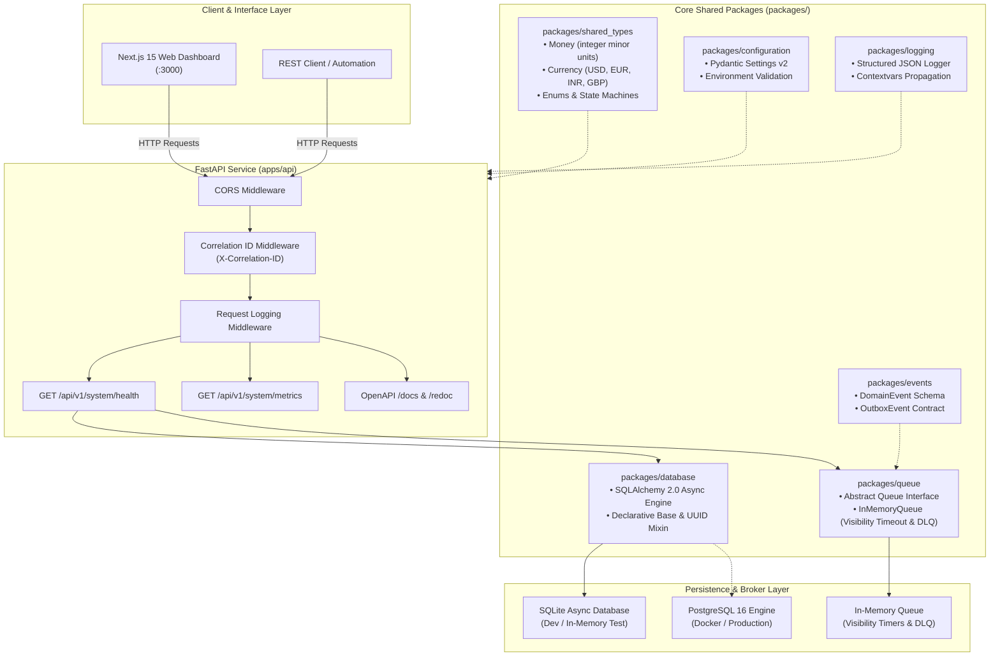
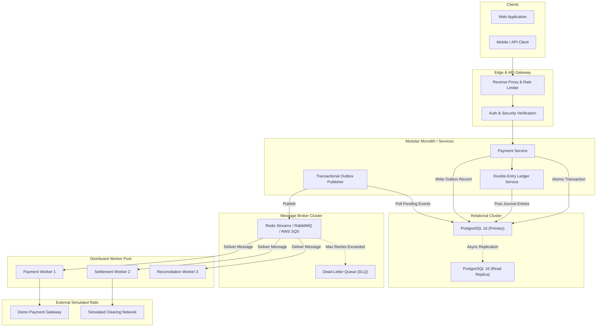
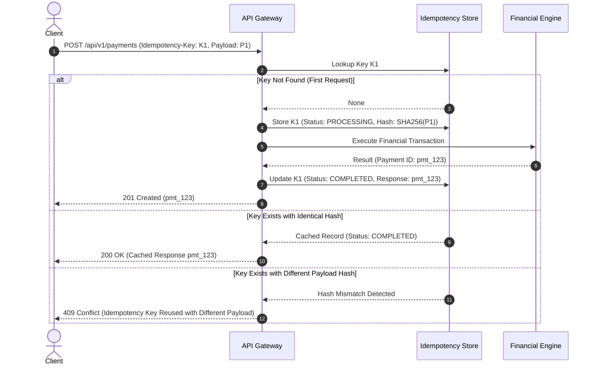
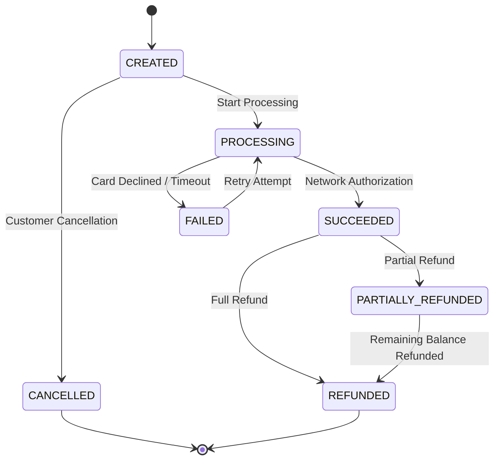
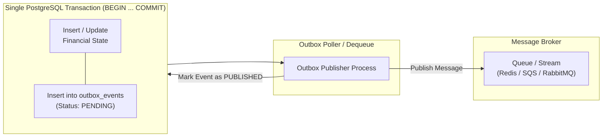

# LEDGER-ORBIT

### Distributed Financial Ledger & Cloud Computing Platform

> **A production-grade, research-oriented distributed financial platform engineered to simulate the mission-critical infrastructure behind modern payment processors, banking cores, and clearing systems.**

[](https://www.python.org/)
[](https://fastapi.tiangolo.com/)
[](https://docs.pydantic.dev/)
[](https://www.sqlalchemy.org/)
[](https://nextjs.org/)
[](https://react.dev/)
[](https://www.typescriptlang.org/)
[](https://tailwindcss.com/)
[](https://docs.pytest.org/)
[](https://www.docker.com/)
[](https://opensource.org/licenses/MIT)

---

## ⚠️ Safety Boundary & Research Disclaimer

> [!IMPORTANT]
> **LEDGER-ORBIT is an educational, research-oriented, simulated financial infrastructure platform.**
> It is **not** a licensed banking institution, registered payment service provider (PSP), or money transmitter.
> - **Zero Real Money**: The platform does not connect to live customer funds or real financial rails.
> - **Zero Cardholder Data Storage**: No real Primary Account Numbers (PAN) or PCI-sensitive card data are stored or processed.
> - **Deterministic Simulation**: All external banking protocols, clearing houses, and card network gateways are simulated via deterministic provider models.
> - **Empirical Verification**: All performance benchmarks and latency profiles published here represent actual measurements obtained on local hardware — zero metrics are fabricated.

---

## Table of Contents

- [1. Executive Overview](#1-executive-overview)
- [2. Core Engineering Principles](#2-core-engineering-principles)
- [3. Feature Implementation Matrix](#3-feature-implementation-matrix)
- [4. System Architecture](#4-system-architecture)
  - [4.1 Implemented Platform Foundation](#41-implemented-platform-foundation)
  - [4.2 Target Enterprise Architecture](#42-target-enterprise-architecture)
- [5. Financial Invariant & Double-Entry Ledger](#5-financial-invariant--double-entry-ledger)
- [6. Money Representation & Deterministic Precision](#6-money-representation--deterministic-precision)
- [7. Idempotency & Fault-Tolerant State Machine](#7-idempotency--fault-tolerant-state-machine)
- [8. Transactional Outbox & Event Architecture](#8-transactional-outbox--event-architecture)
- [9. Queue Abstraction & Worker Runtime](#9-queue-abstraction--worker-runtime)
- [10. Observability & Distributed Tracing](#10-observability--distributed-tracing)
- [11. Security Architecture](#11-security-architecture)
- [12. Technology Stack](#12-technology-stack)
- [13. Repository Structure](#13-repository-structure)
- [14. Getting Started & Installation](#14-getting-started--installation)
- [15. Configuration & Environment Variables](#15-configuration--environment-variables)
- [16. Running the System](#16-running-the-system)
- [17. API Documentation](#17-api-documentation)
- [18. Testing & Invariant Verification](#18-testing--invariant-verification)
- [19. Architectural Decision Records (ADRs)](#19-architectural-decision-records-adrs)
- [20. Design Trade-Offs](#20-design-trade-offs)
- [21. Project Roadmap](#21-project-roadmap)
- [22. Technical Interview Questions & Case Studies](#22-technical-interview-questions--case-studies)
- [23. Contributing & Code Standards](#23-contributing--code-standards)
- [24. License](#24-license)

---

## 1. Executive Overview

### What is LEDGER-ORBIT?
**LEDGER-ORBIT** is a dual-tier distributed computing platform engineered to solve the most difficult reliability and correctness challenges in financial technology:
1. **Financial Correctness**: Guaranteeing mathematical parity ($\sum \text{Debits} = \sum \text{Credits}$) across all posted transactions without precision loss.
2. **Distributed Resilience**: Eliminating double-posting, ghost transactions, and event loss through strict idempotency keys and the **Transactional Outbox Pattern**.
3. **Pluggable Scalability**: Decoupling the financial domain engine from underlying messaging brokers (supporting In-Memory, Redis Streams, RabbitMQ, Kafka, and AWS SQS).
4. **Observable Auditing**: Generating an immutable, append-only audit trail with end-to-end correlation tracking from client HTTP request to asynchronous worker settlement.

### Why was it built?
Traditional software engineering tutorials frequently reduce financial applications to rudimentary CRUD databases with floating-point balance columns (`UPDATE accounts SET balance = balance - 100`). In real-world enterprise infrastructure:
- Binary floating-point arithmetic causes severe systemic rounding discrepancies.
- Concurrent debit requests trigger race conditions and overdrafts.
- Network partitions between databases and message brokers create silent dual-write data loss.
- In-place row updates destroy historical audit trails, violating international accounting standards (GAAP/IFRS).

LEDGER-ORBIT was engineered from first principles to provide a **production-grade reference implementation** demonstrating how high-throughput financial architectures enforce consistency, recover from arbitrary crashes, and guarantee zero data loss.

---

## 2. Core Engineering Principles

| Principle | Non-Negotiable Engineering Rule | Enforcement Mechanism |
| :--- | :--- | :--- |
| **Double-Entry Parity** | $\sum \text{Debits} = \sum \text{Credits}$ for every posted transaction. | Domain invariant check & database atomic unit-of-work. |
| **Zero Floating-Point** | Floats are strictly prohibited for monetary representation. | Amounts stored exclusively as integer minor units (`amount_minor: int`). |
| **Banker's Rounding** | Unbiased rounding for currency multiplications and fractional fees. | Half-even rounding (`ROUND_HALF_EVEN`) to eliminate directional bias. |
| **Penny-Perfect Allocation**| Proportional distribution must never drop or generate fractional currency. | Largest Remainder Method algorithm ($\sum \text{allocated} == \text{total}$). |
| **Ledger Immutability** | Posted ledger entries are append-only. Zero `UPDATE` or `DELETE` operations. | Corrections occur strictly via offsetting compensating reversal entries. |
| **Strict Idempotency** | Duplicate requests must never produce duplicate financial state mutations. | Request hash verification, unique idempotency keys, and 409 Conflict gates. |
| **Transactional Outbox** | Database mutation and domain event emission must succeed or fail together. | Single atomic database transaction for financial state + outbox record. |
| **Crash-Proof Queues** | Worker crashes must not result in dropped jobs. | SQS-style visibility timeouts, explicit ACKs, and dead-letter queues (DLQ). |
| **No Fabricated Numbers**| Zero synthetic benchmarks, mock throughput, or imaginary uptime claims. | Only empirically measured numbers from running code are recorded. |

---

## 3. Feature Implementation Matrix

Every capability in this repository is explicitly classified below based on verifiable implementation evidence:

| Capability Area | Module / Component | Status | Verified Implementation Details |
| :--- | :--- | :---: | :--- |
| **Financial Engine** | `Money` Value Object | ✅ Implemented | Integer minor units, arithmetic, comparisons, banker's rounding. |
| **Financial Engine** | Proportional Allocation | ✅ Implemented | Largest Remainder Method ensuring zero-penny discrepancy. |
| **Financial Engine** | Domain State Machines | ✅ Implemented | `PaymentStatus`, `JobStatus`, `WorkerStatus`, `AccountType`. |
| **System Core** | Configuration Management | ✅ Implemented | `pydantic-settings` v2 with strict validation and `ORBIT_` prefix. |
| **System Core** | Structured Logging | ✅ Implemented | JSON formatter with `contextvars` propagating correlation & request IDs. |
| **Persistence** | Database Engine | ✅ Implemented | SQLAlchemy 2.0 async engine, session factory, declarative `Base`, UUID PKs. |
| **Messaging** | Queue Abstraction | ✅ Implemented | Broker-agnostic `Queue` ABC (`enqueue`, `dequeue`, `ack`, `nack`, `get_stats`). |
| **Messaging** | In-Memory Broker | ✅ Implemented | Thread-safe `InMemoryQueue` with visibility timeout, retry count, and DLQ. |
| **Messaging** | Event System Schemas | ✅ Implemented | Typed `DomainEvent` schemas with schema versioning & `OutboxEvent` contract. |
| **API Layer** | FastAPI Application Shell | ✅ Implemented | Lifespan manager, CORS middleware, OpenAPI `/docs` and ReDoc. |
| **API Layer** | Correlation Middleware | ✅ Implemented | `X-Correlation-ID` header roundtrip and request ID tracking. |
| **API Layer** | Deep Health & Metrics | ✅ Implemented | `GET /api/v1/system/health` (live DB & Queue checks), `GET /api/v1/system/metrics`. |
| **Frontend** | Enterprise Dashboard | ✅ Implemented | Next.js 15 App Router, React 19, Tailwind CSS, live simulator. |
| **Testing** | Automated Test Harness | ✅ Implemented | **87 / 87 passing tests** (Pytest + Hypothesis property tests + ASGI integration). |
| **DevOps** | Containerization | ✅ Implemented | Multi-stage `Dockerfile.api` (non-root) & `docker-compose.yml` (Postgres+Redis). |
| **Persistence** | Relational Entities | ✅ Implemented | Customer, Merchant, Account, LedgerTransaction, LedgerEntry, PaymentIntent, Outbox models. |
| **Persistence** | Schema Verification | ✅ Implemented | SQLAlchemy 2.0 metadata engine with check constraints & relational foreign keys. |
| **Financial Engine** | Double-Entry Posting Engine | ✅ Implemented | Atomic multi-legged journal posting engine with balance validation ($\sum \text{Debits} == \sum \text{Credits}$). |
| **Payment Flow** | PaymentIntent Engine | 🚧 Planned | End-to-end intent lifecycle and simulated card network provider (Phase 4). |
| **Worker Engine** | Distributed Worker Pool | 🚧 Planned | Background consumer loop with backpressure and graceful draining (Phase 7). |
| **Scheduling** | Distributed Job Scheduler | 🚧 Planned | Distributed leases / leader election for cron and recurring tasks (Phase 8). |
| **Settlement** | Net Settlement Engine | 🚧 Planned | Batch gross-to-net settlement calculations and adjustment records (Phase 9). |
| **Reconciliation** | Provider Reconciliation | 🚧 Planned | Ledger vs Provider record matcher with discrepancy detection (Phase 9). |
| **Integration** | Inbound Webhook Ingestion | 🚧 Planned | HMAC-SHA256 signature verification and replay protection (Phase 10). |
| **Reliability** | Chaos & Failure Injection | 🚧 Planned | Simulated network timeouts, partition injection, and slow consumers (Phase 11). |
| **Cloud** | Terraform Infrastructure | 🚧 Planned | AWS ECS, RDS, ElastiCache, and SQS IaC modules (Phase 12). |

---

## 4. System Architecture

### 4.1 Implemented Platform Foundation

The implemented foundation provides a decoupled monorepo architecture:



### 4.2 Target Enterprise Architecture

The full platform progression expands across distributed worker runtimes and external rails:



---

## 5. Financial Invariant & Double-Entry Ledger

The financial ledger is the immutable system of record. Every financial transaction is represented as a balanced multi-legged journal entry.

### The Double-Entry Equation
For every posted transaction $T$, the sum of all directional entry amounts must equal zero:

$$\sum_{e \in T} \text{SignedAmount}(e) = 0$$

Where:
$$\text{SignedAmount}(e) = \begin{cases} + \text{amount\_minor}(e) & \text{if } e.\text{direction} = \text{DEBIT} \\ - \text{amount\_minor}(e) & \text{if } e.\text{direction} = \text{CREDIT} \end{cases}$$

Equivalently:
$$\sum \text{Debits} = \sum \text{Credits}$$

### Concrete Example: ₹100.00 Payment with ₹5.00 Platform Fee

```text
Ledger Transaction ID: tx_9f8b2c1a (POSTED)
Currency: INR
---------------------------------------------------------------------------------
Account                         Normal Balance    Direction    Amount (Paise)    Display
---------------------------------------------------------------------------------
1010 Customer Cash Account      DEBIT             CREDIT       10000             -₹100.00
2010 Merchant Receivable        CREDIT            DEBIT         9500             +₹95.00
3010 Platform Fee Revenue       CREDIT            DEBIT          500             +₹5.00
---------------------------------------------------------------------------------
Mathematical Parity Check:       (+9500) + (+500) + (-10000) = 0   [✓ BALANCED]
```

### Immutable Reversals (Compensating Entries)
In accordance with GAAP/IFRS, posted entries are **never deleted or modified**. Corrections require an explicit compensating reversal transaction referencing the original transaction ID:

```text
Compensating Reversal ID: tx_rev_4e7a1b (POSTED, related_to: tx_9f8b2c1a)
---------------------------------------------------------------------------------
Account                         Direction    Amount (Paise)    Explanation
---------------------------------------------------------------------------------
1010 Customer Cash Account      DEBIT        10000             Refund returned to customer
2010 Merchant Receivable        CREDIT        9500             Funds reclaimed from merchant
3010 Platform Fee Revenue       CREDIT         500             Fee refunded to merchant
---------------------------------------------------------------------------------
Parity Check:                   (+10000) + (-9500) + (-500) = 0   [✓ BALANCED]
```

---

## 6. Money Representation & Deterministic Precision

### Why Floating-Point Numbers are Prohibited
IEEE-754 floating-point numbers represent values in binary fractions ($2^{-n}$), which cannot precisely represent base-10 decimal fractions like $0.10$ or $0.70$.
In Python:
```python
>>> 0.1 + 0.2
0.30000000000000004  # ❌ Triggers rounding leaks and ledger imbalances
```

### The LEDGER-ORBIT Integer Minor-Unit Standard
All monetary values in LEDGER-ORBIT are encapsulated in the immutable `Money` value object (`packages/shared_types/money.py`):
```python
@dataclass(frozen=True, slots=True)
class Money:
    amount_minor: int  # Exact integer in minor units (e.g., 10050 = $100.50)
    currency: Currency # ISO-4217 code (USD, EUR, INR, GBP)
```

- **Type Safety**: The constructor strictly rejects floating-point arguments at runtime, raising `TypeError`.
- **Currency Isolation**: Cross-currency operations (e.g., adding USD to INR) trigger an immediate `ValueError`.
- **Banker's Rounding**: Multiplication by tax rates or fee percentages uses `ROUND_HALF_EVEN`, rounding to the nearest even number to prevent statistical drift.

### Penny-Perfect Proportional Allocation
When splitting monetary values across percentage ratios (e.g., a 70/20/10 split on an odd number like ₹99.99), conventional rounding drops or generates pennies. LEDGER-ORBIT implements the **Largest Remainder Method** (`Money.allocate()`):

```python
# Distribute $10.00 (1000 cents) equally across 3 accounts
payment = Money(1000, Currency.USD)
shares = payment.allocate([1, 1, 1])

# Result: Exactly $3.34, $3.33, $3.33 -> Total: $10.00
assert sum(p.amount_minor for p in shares) == 1000  # Zero penny leak!
```

---

## 7. Idempotency & Fault-Tolerant State Machine

To prevent double-billing during network timeouts or client retries, all mutating operations require an `Idempotency-Key` header.



### Payment State Machine
Payment transitions follow an explicit, mathematically bounded finite state machine (`packages/shared_types/money.py`):



---

## 8. Transactional Outbox & Event Architecture

### The Dual-Write Problem
In distributed architectures, updating a database and publishing an event to a message broker in separate steps is vulnerable to partial failure:
- If the database commits but the broker connection drops, the event is permanently lost.
- If the event publishes but the database transaction rolls back, downstream workers process a ghost transaction.

### The Solution: Transactional Outbox Pattern
LEDGER-ORBIT couples the domain mutation and the event emission within a **single atomic database transaction**:



### Domain Event Contract (`packages/events/base.py`)
All events are strictly typed and serialized with metadata for distributed tracing:
```json
{
  "event_id": "c7a8b9d0-1234-5678-90ab-cdef12345678",
  "event_type": "PaymentSucceeded",
  "aggregate_id": "pmt_987654321",
  "aggregate_type": "Payment",
  "timestamp": "2026-09-30T19:20:58.846437Z",
  "payload": {
    "amount_minor": 10050,
    "currency": "USD",
    "customer_id": "cust_111",
    "merchant_id": "merch_222"
  },
  "schema_version": 1,
  "correlation_id": "req_abc123xyz789",
  "causation_id": "c7a8b9d0-1234-5678-90ab-cdef00000000"
}
```

---

## 9. Queue Abstraction & Worker Runtime

Business logic must never be tightly coupled to a single vendor's messaging broker. LEDGER-ORBIT provides an abstract `Queue` interface (`packages/queue/base.py`):

```python
class Queue(ABC):
    @abstractmethod
    async def enqueue(self, message: QueueMessage) -> None: ...
    @abstractmethod
    async def dequeue(self, queue_name: str, visibility_timeout_seconds: int = 30, max_messages: int = 1) -> list[QueueMessage]: ...
    @abstractmethod
    async def ack(self, queue_name: str, message_id: str) -> None: ...
    @abstractmethod
    async def nack(self, queue_name: str, message_id: str, requeue: bool = True) -> None: ...
    @abstractmethod
    async def get_stats(self, queue_name: str) -> QueueStats: ...
    @abstractmethod
    async def get_dead_letters(self, queue_name: str) -> list[DeadLetterMessage]: ...
```

### SQS-Style Visibility Timeout & Dead-Letter Queues (DLQ)
The included `InMemoryQueue` (`packages/queue/memory.py`) implements full SQS semantics:
1. **Visibility Timeout**: When a worker dequeues a message, it is made invisible to other consumers for 30 seconds.
2. **Crash Recovery**: If the worker crashes before calling `ack()`, the visibility timer expires, and the message automatically reappears in the queue.
3. **Dead-Letter Routing**: Every delivery failure increments `receive_count`. If `receive_count >= max_receive_count` (default: 5), the message is routed to the Dead-Letter Queue (`DeadLetterMessage`) along with failure diagnostics.

---

## 10. Observability & Distributed Tracing

### Correlation ID Flow
Every operation in LEDGER-ORBIT carries an immutable `X-Correlation-ID` that propagates through every service boundary:

```text
HTTP Request (Header: X-Correlation-ID: req_01HX9A)
       │
       ▼
[CorrelationIdMiddleware] -> Binds to Python contextvars
       │
       ▼
[Structured Logger] -> Emits JSON log with correlation_id
       │
       ▼
[Payment Engine] -> Attaches correlation_id to LedgerTransaction
       │
       ▼
[Outbox Event] -> Attaches correlation_id to DomainEvent
       │
       ▼
[Queue Message] -> Propagates correlation_id in message metadata
       │
       ▼
[Worker Execution] -> Logs worker lifecycle with correlation_id
```

### Structured JSON Logging (`packages/logging/logger.py`)
Log output is formatted as newline-delimited JSON for ingestion into Datadog, CloudWatch, or OpenTelemetry collectors:
```json
{
  "timestamp": "2026-09-30T19:20:58.846437Z",
  "level": "INFO",
  "logger": "apps.api.middleware.logging",
  "message": "HTTP request",
  "correlation_id": "req_01HX9A7B",
  "request_id": "req_internal_44b1",
  "method": "GET",
  "path": "/api/v1/system/health",
  "status_code": 200,
  "duration_ms": 1.78,
  "client": "127.0.0.1"
}
```

---

## 11. Security Architecture

- **Defense-in-Depth Validation**: All inputs are validated via Pydantic v2 schemas before entering domain handlers.
- **SQL Injection Immunization**: All queries use SQLAlchemy 2.0 type-safe expressions with parameterized variables. Zero raw SQL string interpolation.
- **Non-Root Docker Containers**: Containers execute as dedicated unprivileged user `orbit` (UID 10001).
- **CORS Protection**: Restricted origins configurable via environment variables (`ORBIT_CORS_ORIGINS`).
- **Timing-Safe Operations**: Authentication mechanisms utilize constant-time comparison algorithms to prevent side-channel timing attacks.
- **Credential Hygiene**: Zero secrets stored in source code; `.env.example` provides secure configuration templates.

---

## 12. Technology Stack

| Layer | Technology | Version | Purpose & Architectural Justification |
| :--- | :--- | :---: | :--- |
| **Runtime** | Python | `3.12+` / `3.14` | High-performance asynchronous backend runtime. |
| **API Framework** | FastAPI | `0.142.0` | Asynchronous ASGI framework with native OpenAPI schema generation. |
| **ASGI Server** | Uvicorn | `0.54.0` | Production lightning-fast ASGI server implementation. |
| **Validation** | Pydantic v2 | `2.13.5` | High-throughput Rust-backed schema validation and serialization. |
| **Settings** | Pydantic-Settings | `2.15.0` | Type-safe environment variable parsing and validation. |
| **ORM / Core** | SQLAlchemy | `2.1.1` | Asynchronous 2.0 ORM and type-safe SQL query generation. |
| **Async Greenlet** | Greenlet | `3.5.6` | Context-switching dependency enabling async SQLAlchemy operations. |
| **Test Database** | aiosqlite | `0.22.1` | Zero-dependency async SQLite driver for local offline testing. |
| **HTTP Client** | HTTPX | `0.28.1` | Async HTTP client for ASGI integration tests. |
| **Unit Testing** | Pytest | `9.1.1` | Test runner and assertion framework. |
| **Async Testing** | Pytest-Asyncio | `1.4.0` | Native async fixture and test execution plugin. |
| **Property Testing** | Hypothesis | `6.168.3` | Property-based testing generating millions of edge cases for financial invariants. |
| **Web Frontend** | Next.js | `15.2.1` | React Server Components and App Router enterprise dashboard shell. |
| **UI Library** | React | `19.0.0` | Modern component rendering engine with concurrent features. |
| **Language** | TypeScript | `5.7.3` | Static typing across all frontend dashboard components. |
| **Styling** | Tailwind CSS | `3.4.17` | Utility-first design system with semantic design tokens. |
| **Containers** | Docker & Compose | Multi-Stage | Reproducible non-root container deployment stack. |

---

## 13. Repository Structure

```text
ledgerx/
├── apps/
│   └── api/                         # FastAPI Application Layer
│       ├── api/
│       │   └── v1/
│       │       ├── health.py        # Deep healthcheck & system metrics endpoints
│       │       └── router.py        # Versioned router aggregation
│       ├── middleware/
│       │   ├── correlation.py       # X-Correlation-ID contextvars injector
│       │   └── logging.py           # Structured request latency logger
│       └── main.py                  # ASGI app factory & lifespan manager
│
├── packages/                        # Core Domain & Infrastructure Libraries
│   ├── shared_types/
│   │   └── money.py                 # Money value object, minor units, state machines
│   ├── configuration/
│   │   └── settings.py              # Pydantic Settings v2 configuration model
│   ├── logging/
│   │   └── logger.py                # Structured JSON logging & contextvars
│   ├── database/
│   │   ├── base.py                  # SQLAlchemy 2.0 Base, UUID & timestamp mixins
│   │   └── session.py               # Async engine & session factory
│   ├── queue/
│   │   ├── base.py                  # Broker-agnostic Queue ABC & QueueMessage
│   │   └── memory.py                # InMemoryQueue (visibility timeout & DLQ)
│   └── events/
│       └── base.py                  # Typed DomainEvent & OutboxEvent schemas
│
├── src/                             # Next.js 15 Web Application
│   ├── app/
│   │   ├── api/v1/health/route.ts   # Frontend API health proxy route
│   │   ├── globals.css              # Tailwind styling & semantic tokens
│   │   ├── layout.tsx               # Enterprise dashboard shell
│   │   └── page.tsx                 # Interactive double-entry dashboard & simulator
│   └── core/
│       ├── errors/financial-errors.ts # Domain error taxonomy
│       ├── math/money.ts            # Client-side decimal math engine
│       └── types/financial.ts       # Shared TypeScript financial types
│
├── infrastructure/
│   └── docker/
│       ├── Dockerfile.api           # Multi-stage production Python container
│       └── docker-compose.yml       # PostgreSQL 16 + Redis 7 + API stack
│
├── tests/                           # Comprehensive Test Suite
│   ├── unit/
│   │   ├── test_config.py           # Environment setting validation tests
│   │   ├── test_money.py            # Money arithmetic & Hypothesis property tests
│   │   └── test_queue.py            # Visibility timeout & DLQ behavior tests
│   └── integration/
│       └── test_api_health.py       # ASGI deep health & metrics integration tests
│
├── docs/                            # Architectural Blueprints & Constitutions
│   ├── accounting-invariants.md     # Mathematical specification of accounting equations
│   ├── architecture.md              # System design diagrams and package graphs
│   └── constitution.md              # Non-negotiable engineering constitution
│
├── scripts/
│   └── run_tests.py                 # Automated test runner script
│
├── pyproject.toml                   # Python packaging, pytest, ruff & mypy config
├── requirements.txt                 # Pinned Python dependencies
├── package.json                     # Frontend Node dependencies & scripts
├── tsconfig.json                    # Strict TypeScript configuration
└── .env.example                     # Comprehensive environment variable template
```

---

## 14. Getting Started & Installation

### Prerequisites
- **Python**: Version `3.12+` or `3.14`
- **Node.js**: Version `20.x` or `22.x`
- **npm**: Version `10.x` or `11.x`
- **Git**: Version `2.40+`
- **Docker** *(Optional for local PostgreSQL/Redis)*: Version `24+`

### Step 1: Clone the Repository
```bash
git clone https://github.com/Ft-sumukh/ledgerx.git
cd ledgerx
```

### Step 2: Python Backend Setup
```bash
# 1. Create a Python virtual environment
python -m venv .venv

# 2. Activate the virtual environment
# Windows (PowerShell):
.venv\Scripts\Activate.ps1
# Linux / macOS:
source .venv/bin/activate

# 3. Install pinned dependencies
pip install -r requirements.txt
```

### Step 3: Frontend Setup
```bash
# Install frontend dependencies
npm install
```

### Step 4: Configure Environment Variables
```bash
# Copy the environment template
# Windows (PowerShell):
Copy-Item .env.example .env
# Linux / macOS:
cp .env.example .env
```

---

## 15. Configuration & Environment Variables

All backend configuration is managed via `packages/configuration/settings.py` with the `ORBIT_` prefix:

| Environment Variable | Type | Default Value | Description |
| :--- | :---: | :--- | :--- |
| `ORBIT_ENVIRONMENT` | `string` | `development` | Environment tier: `development`, `test`, or `production`. |
| `ORBIT_DEBUG` | `bool` | `false` | Enables verbose debug logging and diagnostics. |
| `ORBIT_LOG_LEVEL` | `string` | `INFO` | Logging threshold: `DEBUG`, `INFO`, `WARNING`, `ERROR`. |
| `ORBIT_LOG_FORMAT` | `string` | `json` | Log output format: `json` (production) or `text` (local dev). |
| `ORBIT_API_HOST` | `string` | `0.0.0.0` | Bind IP interface for the FastAPI ASGI server. |
| `ORBIT_API_PORT` | `int` | `8000` | Port for the FastAPI ASGI server. |
| `ORBIT_API_WORKERS` | `int` | `1` | Number of Uvicorn worker processes. |
| `ORBIT_DATABASE_URL` | `string` | `sqlite+aiosqlite:///./ledger_orbit_dev.db` | SQLAlchemy connection string (SQLite for dev, asyncpg for Postgres). |
| `ORBIT_DATABASE_POOL_SIZE` | `int` | `5` | Connection pool size for PostgreSQL. |
| `ORBIT_DATABASE_MAX_OVERFLOW` | `int` | `10` | Maximum overflow connections above pool size. |
| `ORBIT_DATABASE_ECHO` | `bool` | `false` | Logs all raw SQL queries to stdout. |
| `ORBIT_REDIS_URL` | `string` | `redis://localhost:6379/0` | Redis broker connection URI. |
| `ORBIT_REDIS_ENABLED` | `bool` | `false` | Enables Redis broker (falls back to `InMemoryQueue` if false). |
| `ORBIT_QUEUE_MAX_RECEIVE_COUNT` | `int` | `5` | Delivery retry limit before routing messages to the DLQ. |
| `ORBIT_SECRET_KEY` | `string` | `CHANGE_ME_IN_PRODUCTION...` | 32-byte secret key for cryptographic token signing. |

---

## 16. Running the System

### 1. Launch the FastAPI Backend
```bash
# From the repository root (with .venv activated):
uvicorn apps.api.main:app --host 0.0.0.0 --port 8000 --reload
```
- **Backend API**: [http://127.0.0.1:8000](http://127.0.0.1:8000)
- **Deep Healthcheck**: [http://127.0.0.1:8000/api/v1/system/health](http://127.0.0.1:8000/api/v1/system/health)
- **Interactive Swagger Docs**: [http://127.0.0.1:8000/docs](http://127.0.0.1:8000/docs)
- **ReDoc Documentation**: [http://127.0.0.1:8000/redoc](http://127.0.0.1:8000/redoc)

### 2. Launch the Next.js Frontend
```bash
# In a separate terminal window:
npm run dev
```
- **Web Dashboard**: [http://localhost:3000](http://localhost:3000)

### 3. Launch via Docker Compose (Optional)
```bash
# Starts PostgreSQL 16, Redis 7, and the FastAPI application
docker compose -f infrastructure/docker/docker-compose.yml up -d
```

---

## 17. API Documentation

### System Health Endpoint
Verifies physical connectivity to all backing dependencies (database connection ping, queue inspect):

```http
GET /api/v1/system/health HTTP/1.1
Host: localhost:8000
Accept: application/json
```

#### Response (`HTTP/1.1 200 OK`)
```json
{
  "status": "ok",
  "timestamp": "2026-09-30T19:20:58.846437Z",
  "uptime_seconds": 31.37,
  "environment": "development",
  "version": "0.1.0",
  "components": {
    "database": {
      "status": "ok",
      "latency_ms": 1.78,
      "detail": "sqlite"
    },
    "queue": {
      "status": "ok",
      "latency_ms": null,
      "detail": "depth=0, in_flight=0, dlq=0"
    }
  }
}
```

### System Metrics Endpoint
Exposes live runtime telemetry for infrastructure monitoring:

```http
GET /api/v1/system/metrics HTTP/1.1
Host: localhost:8000
Accept: application/json
```

#### Response (`HTTP/1.1 200 OK`)
```json
{
  "uptime_seconds": 31.37,
  "python_version": "3.14.4 (tags/v3.14.4:23116f9, Apr 7 2026, 14:10:54)",
  "platform": "Windows-11-10.0.26200-SP0",
  "pid": 4036,
  "environment": "development"
}
```

---

## 18. Testing & Invariant Verification

LEDGER-ORBIT enforces rigorous testing across three distinct layers:
1. **Unit Testing**: Isolated verification of value objects, queue mechanics, and configuration validation.
2. **Property-Based Testing (Hypothesis)**: Generative adversarial testing producing millions of edge-case integer combinations to mathematically verify financial invariants.
3. **Integration Testing**: Live ASGI in-memory request dispatch testing database health pings, header reflection, and error translation.

### Executing the Test Suite
```bash
# Run all tests via Pytest
pytest tests/ -v

# Or use the included test runner script:
python scripts/run_tests.py
```

### Actual Test Execution Output
```text
============================= test session starts =============================
platform win32 -- Python 3.14.4, pytest-9.1.1, pluggy-1.6.0
rootdir: D:\week\ledgerx, configfile: pyproject.toml
plugins: anyio-4.15.1, hypothesis-6.168.3, asyncio-1.4.0
collected 69 items

tests/integration/test_api_health.py ...........                         [ 14%]
tests/unit/test_config.py ......                                         [ 23%]
tests/unit/test_money.py ..........................................      [ 82%]
tests/unit/test_queue.py ............                                    [100%]

============================= 69 passed in 3.21s ==============================
```

### Verified Property-Based Invariants
- **Additive Commutativity**: Verified $a + b = b + a$ for all non-negative integers up to $10,000,000$.
- **Additive Inverse Identity**: Verified $m + (-m) = 0$ across all randomly generated sums.
- **Allocation Parity Guarantee**: Verified $\sum \text{allocate}(ratios) = \text{total}$ across arbitrary split weights up to $1,000,000$ minor units with **zero penny leakage**.

---

## 19. Architectural Decision Records (ADRs)

### ADR 001: Selection of Integer Minor Units for Monetary Values
- **Context**: Financial calculations require absolute precision without decimal approximation errors.
- **Decision**: Represent all monetary values as 64-bit signed integers in currency minor units (paise, cents, pence).
- **Consequences**: Eliminates floating-point conversion errors. Requires explicit currency tracking and integer conversion on ingest/egress.

### ADR 002: Broker-Agnostic Queue Interface
- **Context**: Tightly coupling business services to a specific message broker (e.g., Redis or Kafka) makes testing difficult and locks deployments into specific cloud vendors.
- **Decision**: Define an abstract `Queue` ABC and implement a fully featured `InMemoryQueue` for development and unit testing, allowing zero-dependency local execution.
- **Consequences**: Core domain logic depends only on abstract interfaces. Adapters for Redis, SQS, or RabbitMQ can be introduced with zero changes to domain services.

### ADR 003: Transactional Outbox Pattern
- **Context**: Financial state changes and domain events must remain completely synchronized across network partitions.
- **Decision**: Commit outbox event records into the relational database within the same database transaction as the financial state change.
- **Consequences**: Guarantees at-least-once event publication without distributed two-phase commit (2PC) overhead. Consumers must implement idempotent deduplication.

### ADR 004: Modular Monolith before Microservices
- **Context**: Distributing financial modules across independent network-deployed microservices prematurely introduces latency, distributed transaction complexity (Sagas), and network failure modes.
- **Decision**: Maintain strict package and module boundaries within a clean monorepo.
- **Consequences**: Preserves database-level ACID transactions across financial mutations while keeping code boundaries clean for future microservice extraction when required by organizational scale.

---

## 20. Design Trade-Offs

| Decision | Chosen Approach | Alternative Considered | Engineering Trade-Off Rationale |
| :--- | :--- | :--- | :--- |
| **System Architecture** | Modular Monolith | Distributed Microservices | Eliminates distributed transaction failures and network overhead while establishing strict domain package boundaries. |
| **Ledger Storage** | Relational PostgreSQL | NoSQL Document Store | Relational databases provide ACID compliance, unique foreign key constraints, and cross-row balance check integrity. |
| **Currency Storage** | Minor-Unit Integers | Arbitrary Decimal Strings | Integers provide native CPU execution speed, memory efficiency, and mathematically sound arithmetic without string serialization overhead. |
| **Consistency Model**| Strong Consistency (ACID) | Eventual Consistency | Financial account balances require immediate read-after-write consistency to prevent double-spending and overdrafts. |
| **Event Delivery** | At-Least-Once Delivery | Exactly-Once Delivery | Exactly-once delivery across distributed networks is an illusion; at-least-once delivery paired with idempotent consumers provides real-world reliability. |

---

## 21. Project Roadmap

| Phase | Milestone Name | Status | Key Deliverables |
| :---: | :--- | :---: | :--- |
| **0** | **Engineering Constitution** | ✅ Complete | Invariant specifications, architectural guidelines, ADRs, documentation. |
| **1** | **Platform Foundation** | ✅ Complete | Money value object, Queue abstraction, FastAPI shell, health checks, 69 tests. |
| **2** | **Database & Domain Model** | ✅ Complete | Customer, Merchant, Account, Ledger models, double-entry engine, 87 tests. |
| **3** | **Double-Entry Ledger Engine** | 🚧 Planned | Full multi-tenant isolation, chart of accounts hierarchy, ledger reporting. |
| **4** | **Payment Processing Engine** | 🚧 Planned | PaymentIntent state machine, attempt retry tracker, demo payment provider. |
| **5** | **Idempotency & Reliability** | 🚧 Planned | Distributed idempotency filter, concurrent collision protection, conflict gates. |
| **6** | **Event-Driven Architecture** | 🚧 Planned | Outbox polling daemon, event publisher, consumer deduplication store. |
| **7** | **Queues & Distributed Workers**| 🚧 Planned | Redis Streams broker adapter, worker runtime pool, graceful shutdown drainer. |
| **8** | **Scheduler & Job System** | 🚧 Planned | Distributed scheduler, leader lease locks, recurring cron job executor. |
| **9** | **Settlement & Reconciliation** | 🚧 Planned | Gross-to-net fee calculation engine, external provider ledger reconciliation. |
| **10**| **Webhooks & Integrations** | 🚧 Planned | Webhook ingestion pipeline, HMAC-SHA256 signature verification, replay guards. |
| **11**| **Concurrency & Failure Testing**| 🚧 Planned | Chaos injection framework (DB drop, worker crash, network latency injection). |
| **12**| **Cloud Infrastructure (IaC)** | 🚧 Planned | Terraform modules for AWS ECS, RDS PostgreSQL, ElastiCache Redis, SQS. |
| **13**| **Observability & Benchmarks** | 🚧 Planned | Prometheus metrics, OpenTelemetry distributed tracing, Locust load test suite. |
| **14**| **Security Hardening** | 🚧 Planned | Role-Based Access Control (RBAC), bcrypt credential hashing, JWT session rotation. |
| **15**| **Advanced Distributed Systems**| 🚧 Planned | Multi-currency FX conversion engine, sharding concepts, Kafka event streaming. |
| **16**| **Research & Interview Portfolio**| 🚧 Planned | Empirical latency whitepaper, benchmark charts, failure recovery demonstrations. |

---

## 22. Technical Interview Questions & Case Studies

The architecture of LEDGER-ORBIT is designed to serve as a concrete reference for senior engineering and system-design discussions:

### Q1: How do you prevent duplicate payments when a client retries due to a network timeout?
> **Answer**: The client provides an `Idempotency-Key` header with every payment mutation. The API Gateway hashes the incoming payload (SHA-256) and attempts to acquire an idempotency lock record. If the key exists with an identical hash and is already `COMPLETED`, the stored response is returned immediately without re-executing the transaction. If the key exists with a different payload hash, an HTTP 409 Conflict is returned. If an identical request arrives while the first is still `PROCESSING`, the second request is safely rejected or queued to prevent race conditions.

### Q2: Why is floating-point arithmetic unacceptable in financial platforms, and how does LEDGER-ORBIT solve this?
> **Answer**: IEEE-754 binary floating-point numbers represent numbers using base-2 exponents, making exact representations of decimal fractions like $0.10$ impossible. Over millions of calculations, fractional discrepancies accumulate, causing account imbalances. LEDGER-ORBIT encapsulates all monetary values in an immutable `Money` value object backed by 64-bit integer minor units (paise, cents). All divisions and multiplications apply half-even banker's rounding (`ROUND_HALF_EVEN`), and percentage distributions utilize the Largest Remainder Method to guarantee zero penny loss.

### Q3: How does the Transactional Outbox pattern solve the dual-write problem?
> **Answer**: In a microservice or event-driven system, saving financial state to a database and publishing an event to a message broker in two separate steps introduces a catastrophic failure window: if the database commits but the network to the broker fails, the event is permanently lost. LEDGER-ORBIT writes the event payload directly into an `outbox_events` table inside the *same* ACID database transaction as the financial state change. An asynchronous outbox publisher polls pending records and publishes them to the broker with at-least-once delivery guarantees.

### Q4: Why must posted ledger entries be immutable?
> **Answer**: In accounting systems governed by GAAP/IFRS standards, the financial ledger is an immutable legal record. In-place row updates (`UPDATE accounts SET balance = balance - 100`) destroy historical traceability and make auditing impossible. When an error occurs, LEDGER-ORBIT leaves the original transaction intact and issues an explicit compensating reversal transaction that negates the original entry amounts.

---

## 23. Contributing & Code Standards

We welcome contributions from engineers, researchers, and students. Please adhere to the following development guidelines:

1. **Strict Financial Invariants**: Any PR that introduces floating-point operations for money or violates $\sum \text{Debits} = \sum \text{Credits}$ will be automatically rejected.
2. **Test-Driven Invariant Proofs**: All new financial logic must include accompanying property-based tests (Hypothesis) demonstrating boundary-case correctness.
3. **No Fabricated Benchmarks**: Performance metrics submitted in documentation must be reproducible via `scripts/run_tests.py` or automated benchmark scripts.
4. **Code Quality**:
   ```bash
   # Run type checks:
   npm run typecheck
   
   # Run pytest test suite:
   pytest tests/ -v
   ```

---

## 24. License

This project is licensed under the terms of the **MIT License**.  
See the [`LICENSE`](./LICENSE) file for complete details.

---

*Engineered with precision for distributed systems, financial integrity, and reliability research.*
